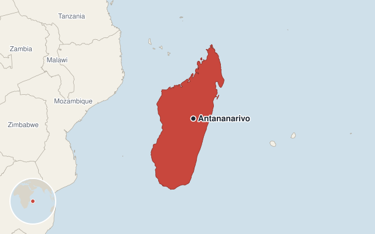

---
id    = "13147f8b-85e4-5bda-b66a-bbf4f771e3d6"
model = "Basic"
tags  = ["africa", "east_africa", "sovereign_state", "country"]
---

## Front

<b>Antananarivo</b> is the capital of which country or territory?

## Back

<b>Madagascar</b>

## Extra

<a href="https://en.wikipedia.org/wiki/Madagascar">Madagascar on Wikipedia</a> <a href="https://en.wikipedia.org/wiki/Antananarivo">Antananarivo on Wikipedia</a>
