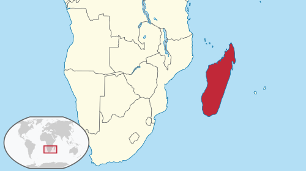
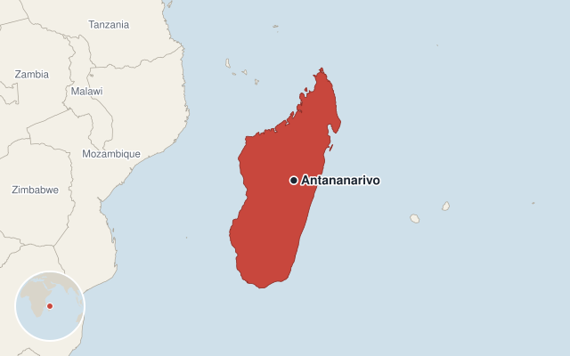

---
id    = "bd4e7523-d065-5719-b27b-d6b1068f604a"
model = "Basic"
tags  = ["africa", "east_africa", "sovereign_state", "map"]
---

## Front

What is highlighted on this map?

## Back

<b>Madagascar</b>

## Extra

<a href="https://en.wikipedia.org/wiki/Madagascar">Madagascar on Wikipedia</a>
