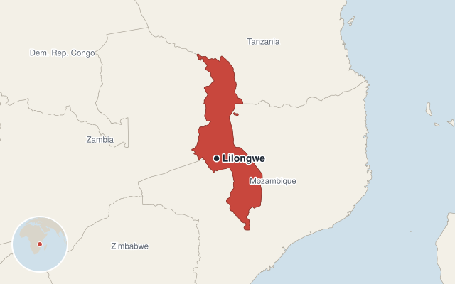

---
id    = "0a1b85a0-93b1-59e9-9e9c-32b79b7d0ba0"
model = "Basic"
tags  = ["africa", "east_africa", "sovereign_state", "capital"]
---

## Front

What is the capital of <b>Malawi</b>?

## Back

<b>Lilongwe</b>

## Extra

<i>Photo: Brian Dell, Public domain, via Wikimedia Commons</i>

About 1.34 million people (2026 census) 1,050 m up, in the central region

Named after the Lilongwe River. It replaced Zomba as capital in 1975, a move decided in 1965 under the first president, Hastings Banda.

<a href="https://en.wikipedia.org/wiki/Lilongwe">Lilongwe on Wikipedia</a> <a href="https://en.wikipedia.org/wiki/Malawi">Malawi on Wikipedia</a>
