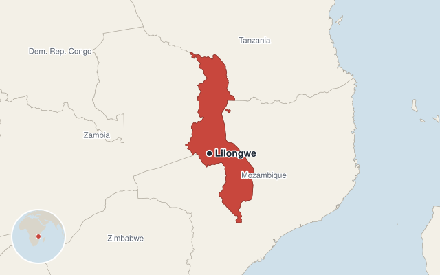

---
id    = "4d45c114-3548-52ad-9f85-34d462b28068"
model = "Basic"
tags  = ["africa", "east_africa", "sovereign_state", "country"]
---

## Front

<b>Lilongwe</b> is the capital of which country or territory?

## Back

<b>Malawi</b>

## Extra

<a href="https://en.wikipedia.org/wiki/Malawi">Malawi on Wikipedia</a> <a href="https://en.wikipedia.org/wiki/Lilongwe">Lilongwe on Wikipedia</a>
