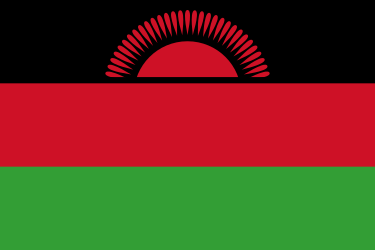
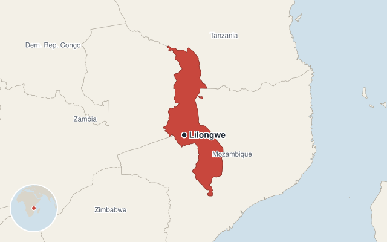

---
id    = "d96b41e2-a250-537a-aa35-63a414af1070"
model = "Basic"
tags  = ["africa", "east_africa", "sovereign_state", "flag"]
---

## Front

Whose flag is this?

## Back

<b>Malawi</b>

## Extra

Adopted on 6 July 1964, restored in 2012

The rising sun stands for the dawn of hope and freedom for Africa. Black is for the continent's people, red for the blood of their struggle and green for nature.

<a href="https://en.wikipedia.org/wiki/Flag_of_Malawi">Flag of Malawi on Wikipedia</a> <a href="https://en.wikipedia.org/wiki/Malawi">Malawi on Wikipedia</a>
