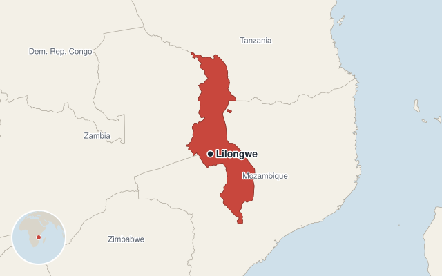

---
id    = "101f7bd1-920d-56e8-a159-8465fb9841d8"
model = "Basic"
tags  = ["africa", "east_africa", "sovereign_state", "map"]
---

## Front

What is highlighted on this map?

## Back

<b>Malawi</b>

## Extra

Zambia to the northwest, Tanzania to the northeast, Mozambique to the south, southwest and east

The Great Rift Valley runs through Malawi from north to south, and Lake Malawi lies to the east of it. The Shire River flows from the lake's south end and joins the Zambezi in Mozambique.

<a href="https://en.wikipedia.org/wiki/Malawi">Malawi on Wikipedia</a>
