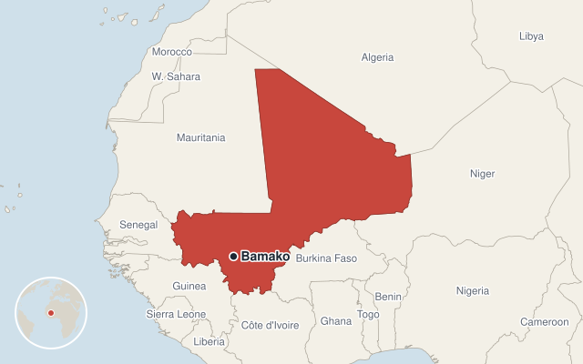

---
id    = "8f082dab-a9ec-517b-8f36-9e8796bc0961"
model = "Basic"
tags  = ["africa", "sovereign_state", "west_africa", "capital"]
---

## Front

What is the capital of <b>Mali</b>?

## Back

<b>Bamako</b>

## Extra

About 4.2 million people (2022) On the Niger River, near the rapids that divide the upper and middle Niger valleys

It was founded around 1650 by the Niare family. It grew quickly after a railway reached it in 1904 and it became capital of French Sudan in 1908.

<a href="https://en.wikipedia.org/wiki/Bamako">Bamako on Wikipedia</a> <a href="https://en.wikipedia.org/wiki/Mali">Mali on Wikipedia</a>
