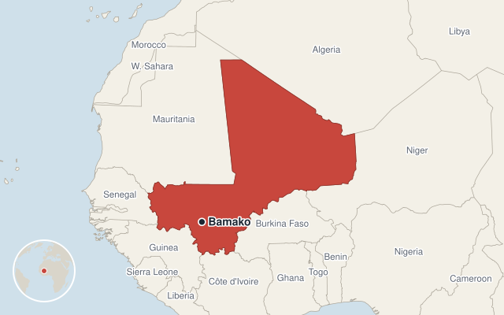

---
id    = "7b04a47a-c5a1-5fc9-9b30-67189af68c21"
model = "Basic"
tags  = ["africa", "sovereign_state", "west_africa", "country"]
---

## Front

<b>Bamako</b> is the capital of which country or territory?

## Back

<b>Mali</b>

## Extra

<a href="https://en.wikipedia.org/wiki/Mali">Mali on Wikipedia</a> <a href="https://en.wikipedia.org/wiki/Bamako">Bamako on Wikipedia</a>
