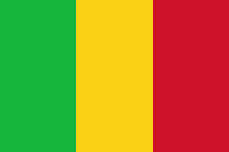

---
id    = "a358a2db-7087-5bad-b39d-31250821d5a2"
model = "Basic"
tags  = ["africa", "sovereign_state", "west_africa", "flag"]
---

## Front

Whose flag is this?

## Back

<b>Mali</b>

## Extra

Similar flags: Guinea (green and red flipped, slightly darker green)
