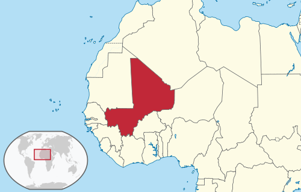
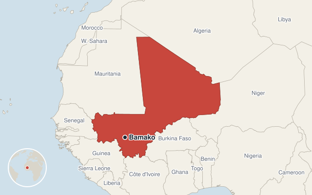

---
id    = "d8587ea6-ea6f-558f-baa5-332985d38375"
model = "Basic"
tags  = ["africa", "sovereign_state", "west_africa", "map"]
---

## Front

What is highlighted on this map?

## Back

<b>Mali</b>

## Extra

Borders Algeria, Niger, Burkina Faso, Ivory Coast, Guinea, Senegal and Mauritania About 1.24 million km²

Its northern borders reach deep into the Sahara Desert. Southern Mali, where most people live, is savanna crossed by the Niger and Senegal rivers.

<a href="https://en.wikipedia.org/wiki/Mali">Mali on Wikipedia</a>
