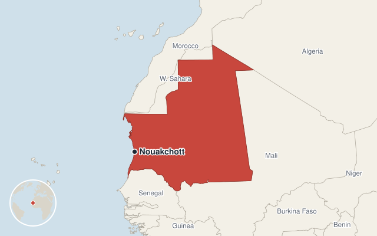

---
id    = "806d65bd-00b6-5a0d-878e-d62308ffc49b"
model = "Basic"
tags  = ["africa", "sovereign_state", "west_africa", "capital"]
---

## Front

What is the capital of <b>Mauritania</b>?

## Back

<b>Nouakchott</b>

## Extra

<a href="https://en.wikipedia.org/wiki/Nouakchott">Nouakchott on Wikipedia</a> <a href="https://en.wikipedia.org/wiki/Mauritania">Mauritania on Wikipedia</a>
