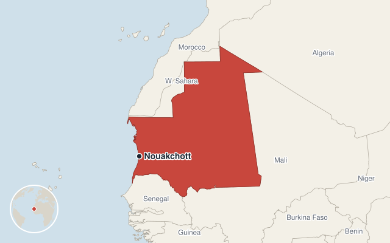

---
id    = "bbab0b60-52bf-559c-875c-148b96e5190c"
model = "Basic"
tags  = ["africa", "sovereign_state", "west_africa", "country"]
---

## Front

<b>Nouakchott</b> is the capital of which country or territory?

## Back

<b>Mauritania</b>

## Extra

<a href="https://en.wikipedia.org/wiki/Mauritania">Mauritania on Wikipedia</a> <a href="https://en.wikipedia.org/wiki/Nouakchott">Nouakchott on Wikipedia</a>
