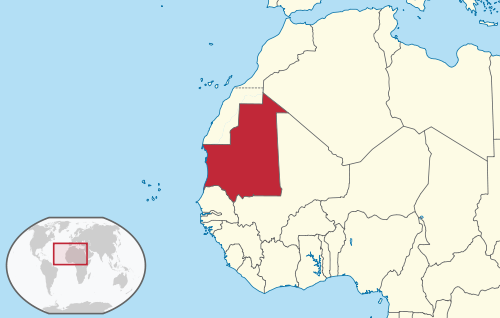

---
id    = "de8f3b13-3615-58f3-b975-088bbda26fe2"
model = "Basic"
tags  = ["africa", "sovereign_state", "west_africa", "map"]
---

## Front

What is highlighted on this map?

## Back

<b>Mauritania</b>
