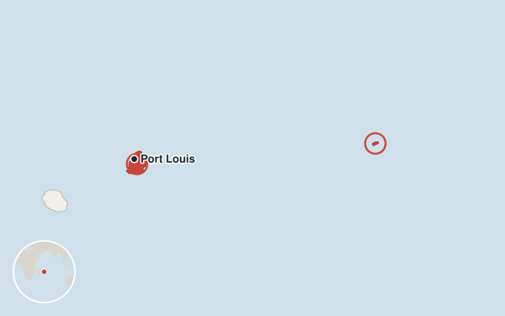

---
id    = "37242b05-566a-5330-ba2f-63697cd2bd0a"
model = "Basic"
tags  = ["africa", "east_africa", "sovereign_state", "capital"]
---

## Front

What is the capital of <b>Mauritius</b>?

## Back

<b>Port Louis</b>

## Extra

<a href="https://en.wikipedia.org/wiki/Port_Louis">Port Louis on Wikipedia</a> <a href="https://en.wikipedia.org/wiki/Mauritius">Mauritius on Wikipedia</a>
