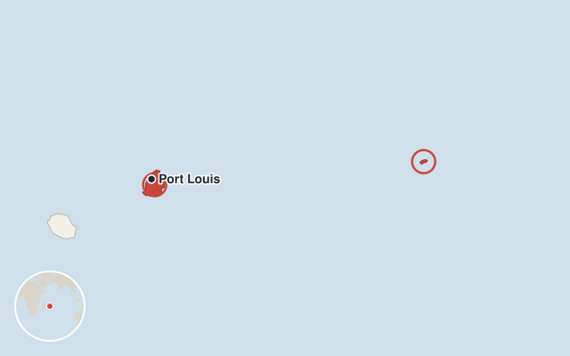

---
id    = "14b2ce86-8d42-59ea-ac57-0c8eaceb0624"
model = "Basic"
tags  = ["africa", "east_africa", "sovereign_state", "country"]
---

## Front

<b>Port Louis</b> is the capital of which country or territory?

## Back

<b>Mauritius</b>

## Extra

An island country in the Indian Ocean, about 2,000 km off the southeast coast of Africa About 1.26 million people (2017)

The Dutch named it in 1598 for Prince Maurice of Nassau. Under French rule from 1715 it was Isle de France, and the name Mauritius returned under British rule.

<a href="https://en.wikipedia.org/wiki/Mauritius">Mauritius on Wikipedia</a> <a href="https://en.wikipedia.org/wiki/Port_Louis">Port Louis on Wikipedia</a>
