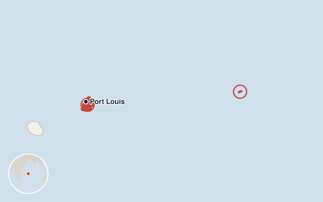

---
id    = "a78149d4-00c0-5db8-aab8-bee315b3367c"
model = "Basic"
tags  = ["africa", "east_africa", "sovereign_state", "flag"]
---

## Front

Whose flag is this?

## Back

<b>Mauritius</b>

## Extra

<a href="https://en.wikipedia.org/wiki/Flag_of_Mauritius">Flag of Mauritius on Wikipedia</a> <a href="https://en.wikipedia.org/wiki/Mauritius">Mauritius on Wikipedia</a>
