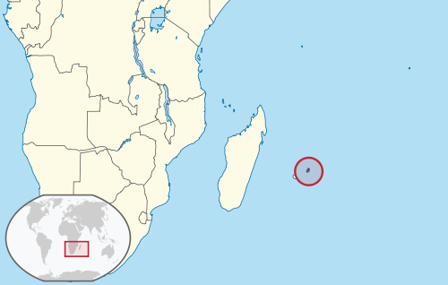
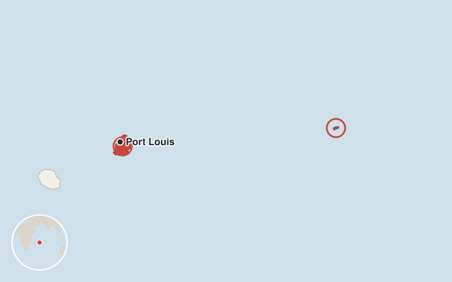
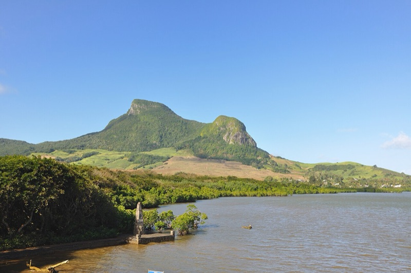

---
id    = "196e7e64-ed8f-5c66-bced-4fb6997add5f"
model = "Basic"
tags  = ["africa", "east_africa", "sovereign_state", "map"]
---

## Front

What is highlighted on this map?

## Back

<b>Mauritius</b>

## Extra

<i>Photo: Simisa (talk · contribs), CC BY-SA 3.0, via Wikimedia Commons</i>

About 2,040 km², with outlying islands including Rodrigues and Agaléga One of the Mascarene Islands, east of Madagascar

The main island, where the population is concentrated, was the only known home of the dodo, which became extinct soon after human settlement.

<a href="https://en.wikipedia.org/wiki/Mauritius">Mauritius on Wikipedia</a>
