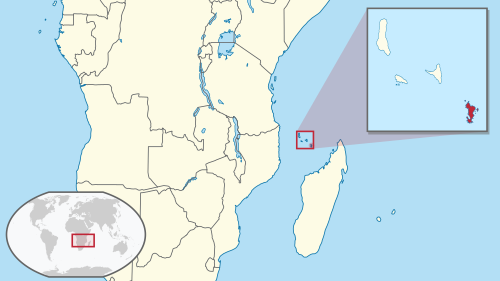

---
id    = "b9622bdf-26de-5d27-a75f-f9402de15266"
model = "Basic"
tags  = ["africa", "east_africa", "map"]
---

## Front

What is highlighted on this map?

## Back

<b>Mayotte</b>

## Extra

About 321,000 people (2024 estimate) in 374 km² Two main islands, Grande-Terre and Petite-Terre, in the northern Mozambique Channel

Grande-Terre is geologically the oldest of the Comoro Islands, 39 km long and 22 km wide, with Mount Benara reaching 660 m. A coral reef encircles much of the island.

Overseas department of France.

<a href="https://en.wikipedia.org/wiki/Mayotte">Mayotte on Wikipedia</a>
