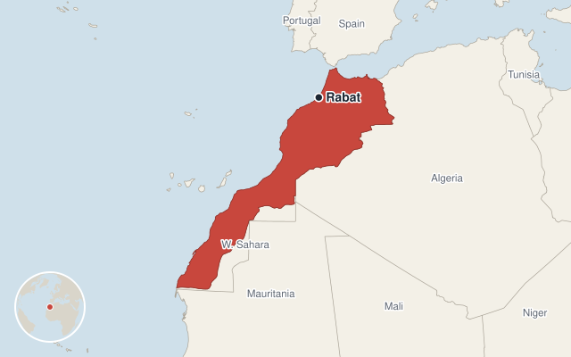

---
id    = "1f2312f1-ca50-54f3-afb9-4c4024f21a1e"
model = "Basic"
tags  = ["africa", "mediterranean", "sovereign_state", "capital"]
---

## Front

What is the capital of <b>Morocco</b>?

## Back

<b>Rabat</b>

## Extra

<a href="https://en.wikipedia.org/wiki/Rabat">Rabat on Wikipedia</a> <a href="https://en.wikipedia.org/wiki/Morocco">Morocco on Wikipedia</a>
