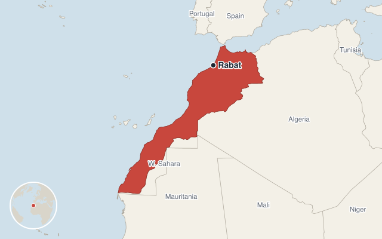

---
id    = "28e71c52-871c-5827-90b4-40aee0956dfe"
model = "Basic"
tags  = ["africa", "mediterranean", "sovereign_state", "country"]
---

## Front

<b>Rabat</b> is the capital of which country or territory?

## Back

<b>Morocco</b>

## Extra

<a href="https://en.wikipedia.org/wiki/Morocco">Morocco on Wikipedia</a> <a href="https://en.wikipedia.org/wiki/Rabat">Rabat on Wikipedia</a>
