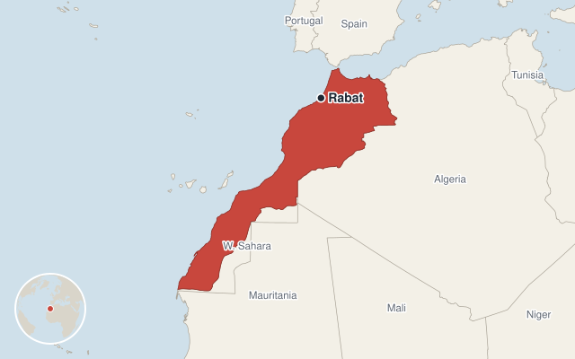

---
id    = "ddeadf56-e029-5f73-b9b4-e7f4cdfb4417"
model = "Basic"
tags  = ["africa", "mediterranean", "sovereign_state", "flag"]
---

## Front

Whose flag is this?

## Back

<b>Morocco</b>

## Extra

Current design introduced by a dahir signed on 17 November 1915

The green pentagram stands for the five pillars of Islam, and the red for the blood of the ancestors and unity. Red is also the colour of the ruling Alawi dynasty, whose early flag was plain red.

<a href="https://en.wikipedia.org/wiki/Flag_of_Morocco">Flag of Morocco on Wikipedia</a> <a href="https://en.wikipedia.org/wiki/Morocco">Morocco on Wikipedia</a>
