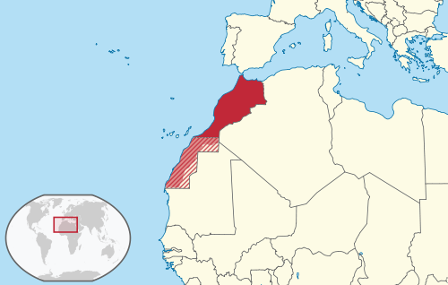
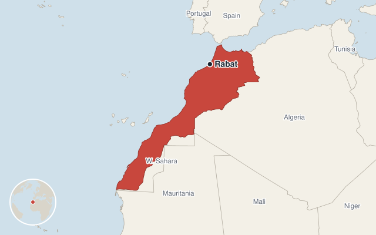

---
id    = "be79f90d-f6bb-5810-b77c-2befee375bc7"
model = "Basic"
tags  = ["africa", "mediterranean", "sovereign_state", "map"]
---

## Front

What is highlighted on this map?

## Back

<b>Morocco</b>

## Extra

Coasts on the Mediterranean Sea to the north and the Atlantic Ocean to the west Borders Algeria to the east, with Western Sahara to the south

One of only three countries, with Spain and France, to have both Atlantic and Mediterranean coastlines. Its geography runs from the Atlantic through mountains to the Sahara desert.

<a href="https://en.wikipedia.org/wiki/Morocco">Morocco on Wikipedia</a>
