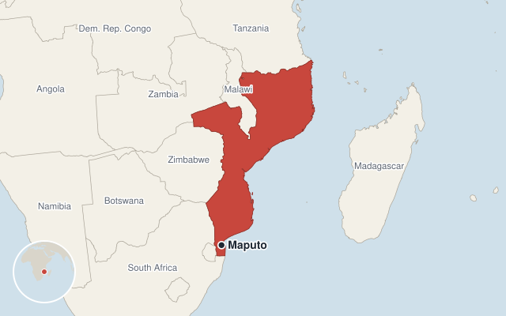

---
id    = "f940f0ce-7fd1-5424-945d-b374a7ae34a8"
model = "Basic"
tags  = ["africa", "east_africa", "sovereign_state", "capital"]
---

## Front

What is the capital of <b>Mozambique</b>?

## Back

<b>Maputo</b>

## Extra

<a href="https://en.wikipedia.org/wiki/Maputo">Maputo on Wikipedia</a> <a href="https://en.wikipedia.org/wiki/Mozambique">Mozambique on Wikipedia</a>
