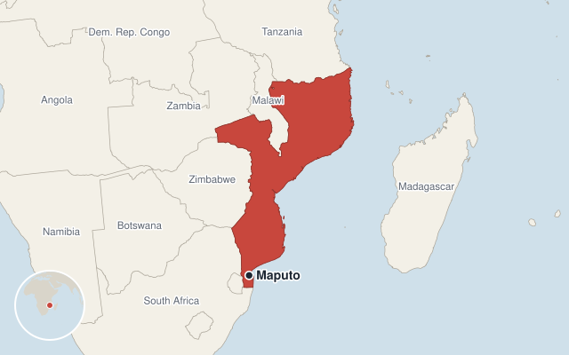

---
id    = "b6f61971-b6ad-54e6-9a00-b62c430b0449"
model = "Basic"
tags  = ["africa", "east_africa", "sovereign_state", "country"]
---

## Front

<b>Maputo</b> is the capital of which country or territory?

## Back

<b>Mozambique</b>

## Extra

<a href="https://en.wikipedia.org/wiki/Mozambique">Mozambique on Wikipedia</a> <a href="https://en.wikipedia.org/wiki/Maputo">Maputo on Wikipedia</a>
