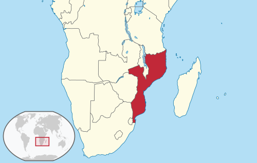
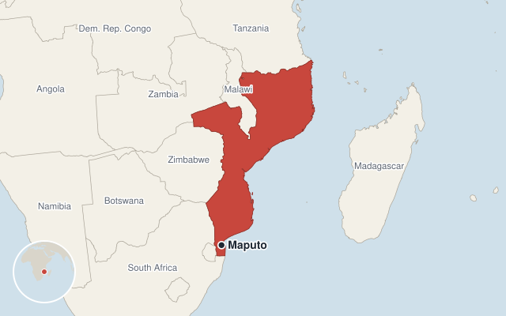

---
id    = "5792f316-c7f7-5228-85fd-52296a882bf5"
model = "Basic"
tags  = ["africa", "east_africa", "sovereign_state", "map"]
---

## Front

What is highlighted on this map?

## Back

<b>Mozambique</b>

## Extra

<a href="https://en.wikipedia.org/wiki/Mozambique">Mozambique on Wikipedia</a>
