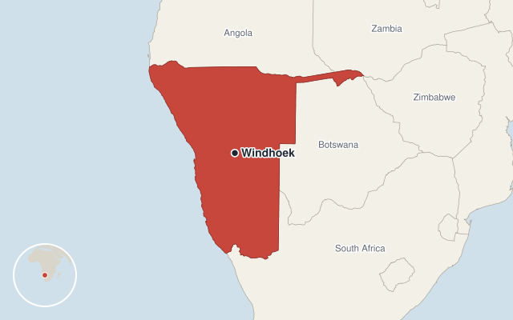

---
id    = "f0a72bf7-b8ba-5f73-9465-5d34d3c7fd6a"
model = "Basic"
tags  = ["africa", "sovereign_state", "capital"]
---

## Front

What is the capital of <b>Namibia</b>?

## Back

<b>Windhoek</b>

## Extra

About 486,000 people (2023), the country's largest city On the Khomas Highland plateau, around 1,700 m above sea level

It grew at a hot spring known to local pastoral tribes, then was founded a second time in 1890 by a German army major when the territory was colonised by the German Empire.

<a href="https://en.wikipedia.org/wiki/Windhoek">Windhoek on Wikipedia</a> <a href="https://en.wikipedia.org/wiki/Namibia">Namibia on Wikipedia</a>
