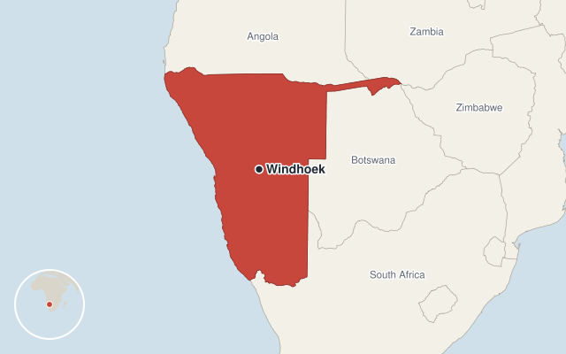

---
id    = "ae78bd60-fcc2-5dfd-86fa-bc10530b28e1"
model = "Basic"
tags  = ["africa", "sovereign_state", "country"]
---

## Front

<b>Windhoek</b> is the capital of which country or territory?

## Back

<b>Namibia</b>

## Extra

About 2.5 million people (2017) Highest point: Brandberg

The driest country in sub-Saharan Africa, with the Atlantic Ocean on its west coast. It became independent from South Africa in 1990.

<a href="https://en.wikipedia.org/wiki/Namibia">Namibia on Wikipedia</a> <a href="https://en.wikipedia.org/wiki/Windhoek">Windhoek on Wikipedia</a>
