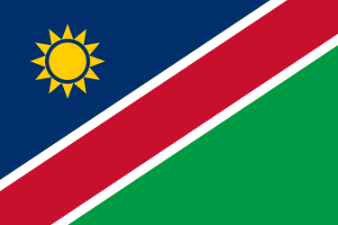
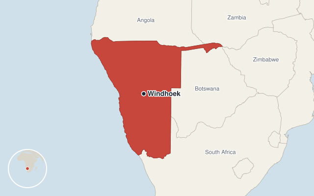

---
id    = "c1c26b79-13cd-53ba-a683-84b7e62d4894"
model = "Basic"
tags  = ["africa", "sovereign_state", "flag"]
---

## Front

Whose flag is this?

## Back

<b>Namibia</b>

## Extra

Adopted on 21 March 1990, at independence

Red for the people, white for peace, green for vegetation and agriculture, blue for the sky and the Atlantic. The golden sun's twelve rays stand for twelve ethnicities.

<a href="https://en.wikipedia.org/wiki/Flag_of_Namibia">Flag of Namibia on Wikipedia</a> <a href="https://en.wikipedia.org/wiki/Namibia">Namibia on Wikipedia</a>
