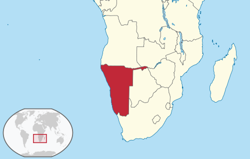
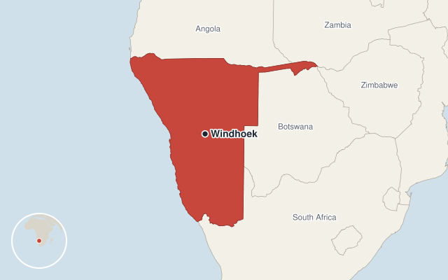

---
id    = "61d56764-be4f-551d-9dd7-1a624d331837"
model = "Basic"
tags  = ["africa", "sovereign_state", "map"]
---

## Front

What is highlighted on this map?

## Back

<b>Namibia</b>

## Extra

<a href="https://en.wikipedia.org/wiki/Namibia">Namibia on Wikipedia</a>
