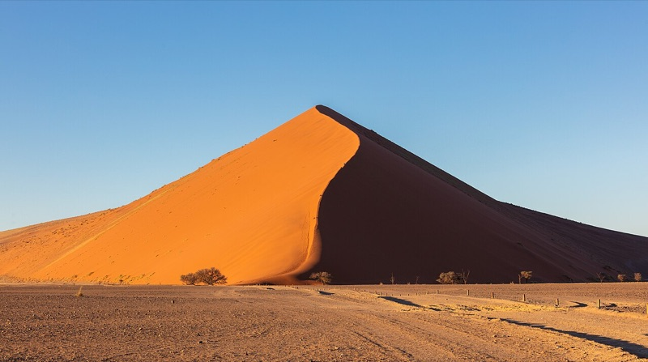

---
id    = "61d56764-be4f-551d-9dd7-1a624d331837"
model = "Basic"
tags  = ["africa", "sovereign_state", "map"]
---

## Front

What is highlighted on this map?

## Back

<b>Namibia</b>

## Extra

<i>Photo: Diego Delso, Diego Delso, via Wikimedia Commons</i>

Borders Angola, Zambia, Botswana and South Africa About 826,000 km2

The narrow Caprivi Strip in the northeast is how Namibia reaches Zambia. Near Kazungula, Zimbabwe lies less than 200 metres away across the Zambezi.

<a href="https://en.wikipedia.org/wiki/Namibia">Namibia on Wikipedia</a>
