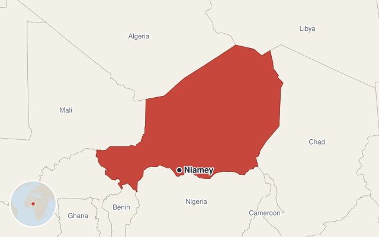
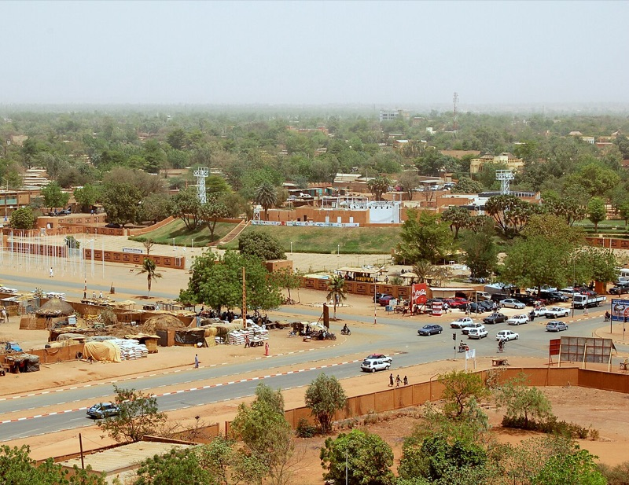

---
id    = "b6a4f1c0-6ecc-5ad3-a5c5-01bace56fa0a"
model = "Basic"
tags  = ["africa", "sovereign_state", "west_africa", "capital"]
---

## Front

What is the capital of <b>Niger</b>?

## Back

<b>Niamey</b>

## Extra

<i>Photo: Roland Huziaker, CC BY-SA 2.0, via Wikimedia Commons</i>

About 1.5 million people (2024), the largest city On the left bank of the Niger River, 207 m up

Before the French made it a colonial centre, the site held villages of Fula, Zarma, Maouri and Songhai people. A French military post was set up there in 1901.

<a href="https://en.wikipedia.org/wiki/Niamey">Niamey on Wikipedia</a> <a href="https://en.wikipedia.org/wiki/Niger">Niger on Wikipedia</a>
