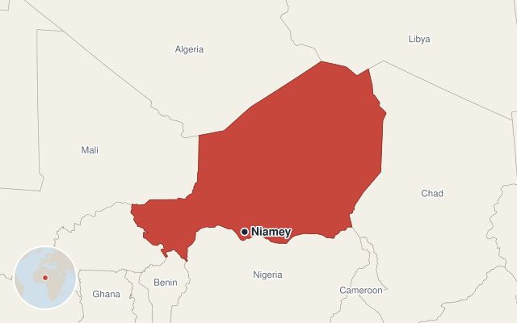

---
id    = "638fcdfc-1f4c-5c02-b299-118b218c9a89"
model = "Basic"
tags  = ["africa", "sovereign_state", "west_africa", "country"]
---

## Front

<b>Niamey</b> is the capital of which country or territory?

## Back

<b>Niger</b>

## Extra

<a href="https://en.wikipedia.org/wiki/Niger">Niger on Wikipedia</a> <a href="https://en.wikipedia.org/wiki/Niamey">Niamey on Wikipedia</a>
