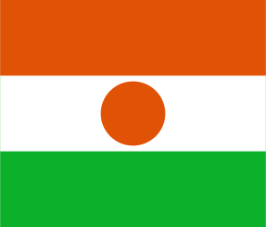
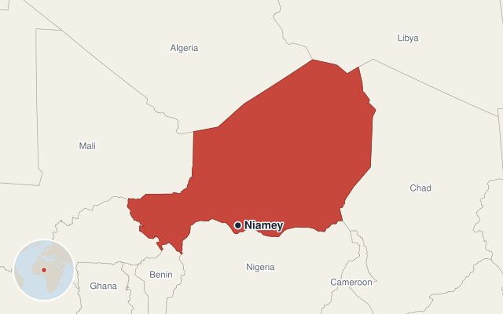

---
id    = "d620201a-52a7-53f7-a0ee-b576fef0871d"
model = "Basic"
tags  = ["africa", "sovereign_state", "west_africa", "flag"]
---

## Front

Whose flag is this?

## Back

<b>Niger</b>

## Extra

<a href="https://en.wikipedia.org/wiki/Flag_of_Niger">Flag of Niger on Wikipedia</a> <a href="https://en.wikipedia.org/wiki/Niger">Niger on Wikipedia</a>
