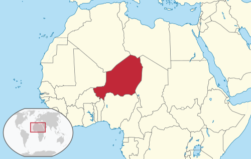
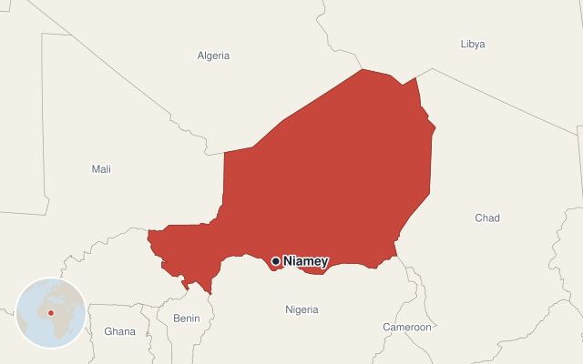

---
id    = "6b6dcd60-3604-55ce-8ec8-5240cfe48aaf"
model = "Basic"
tags  = ["africa", "sovereign_state", "west_africa", "map"]
---

## Front

What is highlighted on this map?

## Back

<b>Niger</b>

## Extra

Borders Libya, Chad, Nigeria, Benin, Burkina Faso, Mali and Algeria The capital lies in the southwest corner

Landlocked: the second-largest landlocked country in Africa, behind Chad. Over 80% of its area lies in the Sahara.

<a href="https://en.wikipedia.org/wiki/Niger">Niger on Wikipedia</a>
