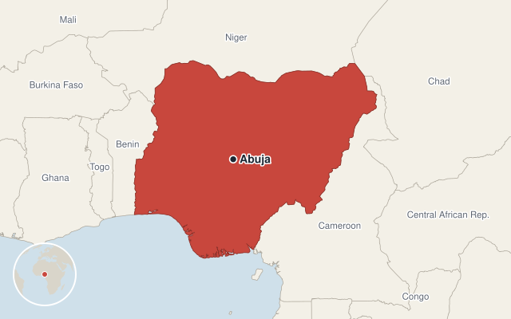
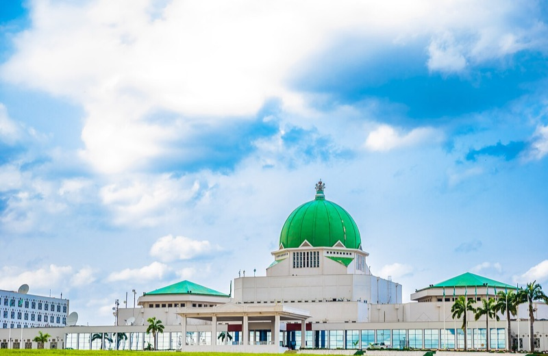

---
id    = "628db719-f4dc-5b4e-ab15-ba8607ad6bfd"
model = "Basic"
tags  = ["africa", "sovereign_state", "west_africa", "capital"]
---

## Front

What is the capital of <b>Nigeria</b>?

## Back

<b>Abuja</b>

## Extra

<i>Photo: Ovinuchi Prince Ejiohuo, CC BY-SA 4.0, via Wikimedia Commons</i>

About 1.7 million people (2022) At the geographic midpoint of the country, 360 m up

It replaced Lagos as the capital on 12 December 1991. Its geography is defined by Aso Rock, a 400-metre monolith left by water erosion.

<a href="https://en.wikipedia.org/wiki/Abuja">Abuja on Wikipedia</a> <a href="https://en.wikipedia.org/wiki/Nigeria">Nigeria on Wikipedia</a>
