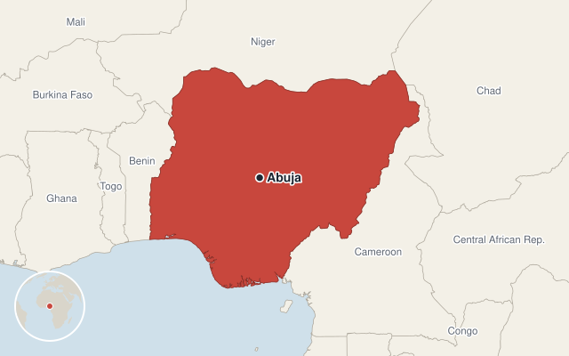

---
id    = "eeb3d09a-4fbd-57d9-af4f-c421d2c684e6"
model = "Basic"
tags  = ["africa", "sovereign_state", "west_africa", "country"]
---

## Front

<b>Abuja</b> is the capital of which country or territory?

## Back

<b>Nigeria</b>

## Extra

About 211 million people (2021), the most in Africa Highest point: Chappal Waddi

More than 250 ethnic groups live here. The Hausa, Yoruba and Igbo together make up over 60% of the population, and the country is split roughly in half between Muslims and Christians.

<a href="https://en.wikipedia.org/wiki/Nigeria">Nigeria on Wikipedia</a> <a href="https://en.wikipedia.org/wiki/Abuja">Abuja on Wikipedia</a>
