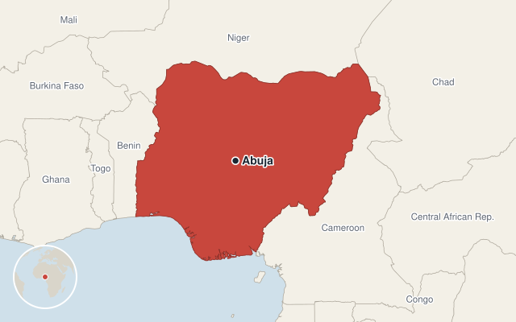

---
id    = "862f8193-894f-5a4e-916e-4bd41e71ede1"
model = "Basic"
tags  = ["africa", "sovereign_state", "west_africa", "flag"]
---

## Front

Whose flag is this?

## Back

<b>Nigeria</b>

## Extra

<a href="https://en.wikipedia.org/wiki/Flag_of_Nigeria">Flag of Nigeria on Wikipedia</a> <a href="https://en.wikipedia.org/wiki/Nigeria">Nigeria on Wikipedia</a>
