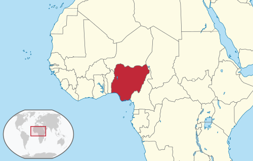

---
id    = "c2a750db-2d77-5b2d-be7b-4527fb679f42"
model = "Basic"
tags  = ["africa", "sovereign_state", "west_africa", "map"]
---

## Front

What is highlighted on this map?

## Back

<b>Nigeria</b>
