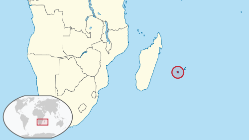

---
id    = "c66e3c30-9bd2-5107-8147-db0e13408748"
model = "Basic"
tags  = ["africa", "east_africa", "map"]
---

## Front

What is highlighted on this map?

## Back

<b>Réunion</b>

## Extra

An overseas department of France, about 890,000 people (2023) 679 km east of Madagascar, 175 km southwest of Mauritius

Piton de la Fournaise is one of Earth's most active volcanoes. Piton des Neiges, the island's highest point at 3,070 m, is dormant.

Overseas department of France.

<a href="https://en.wikipedia.org/wiki/R%C3%A9union">Réunion on Wikipedia</a>
