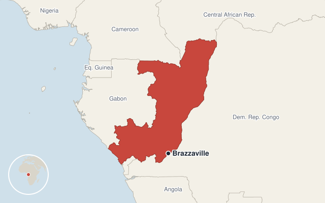

---
id    = "29d632e8-8b6c-514f-a6d3-bbdc3481b60c"
model = "Basic"
tags  = ["africa", "sovereign_state", "capital"]
---

## Front

What is the capital of <b>Republic of the Congo</b>?

## Back

<b>Brazzaville</b>

## Extra

About 2.1 million people (2023), over a third of the country On the north bank of the Congo River, opposite Kinshasa

Named for the explorer Pierre Savorgnan de Brazza, credited with founding the town. From 1940 to 1942 it was the de facto capital of Free France.

<a href="https://en.wikipedia.org/wiki/Brazzaville">Brazzaville on Wikipedia</a> <a href="https://en.wikipedia.org/wiki/Republic_of_the_Congo">Republic of the Congo on Wikipedia</a>
