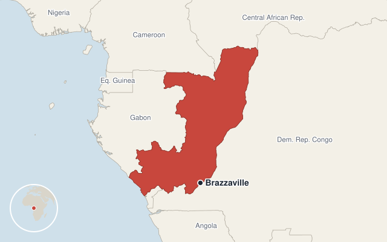

---
id    = "be5e28df-8f82-5a2f-a9de-0c202139a3dc"
model = "Basic"
tags  = ["africa", "sovereign_state", "country"]
---

## Front

<b>Brazzaville</b> is the capital of which country or territory?

## Back

<b>Republic of the Congo</b>

## Extra

<a href="https://en.wikipedia.org/wiki/Republic_of_the_Congo">Republic of the Congo on Wikipedia</a> <a href="https://en.wikipedia.org/wiki/Brazzaville">Brazzaville on Wikipedia</a>
