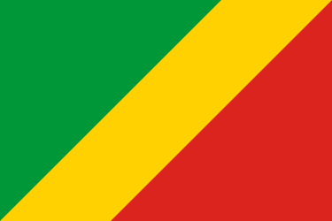
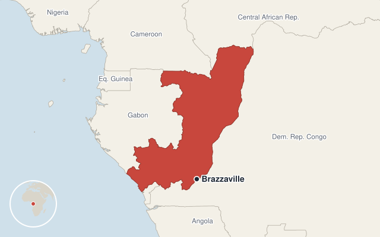

---
id    = "94cc8493-02b3-5098-ae89-b967123974a5"
model = "Basic"
tags  = ["africa", "sovereign_state", "flag"]
---

## Front

Whose flag is this?

## Back

<b>Republic of the Congo</b>

## Extra

<a href="https://en.wikipedia.org/wiki/Flag_of_the_Republic_of_the_Congo">Flag of the Republic of the Congo on Wikipedia</a> <a href="https://en.wikipedia.org/wiki/Republic_of_the_Congo">Republic of the Congo on Wikipedia</a>
