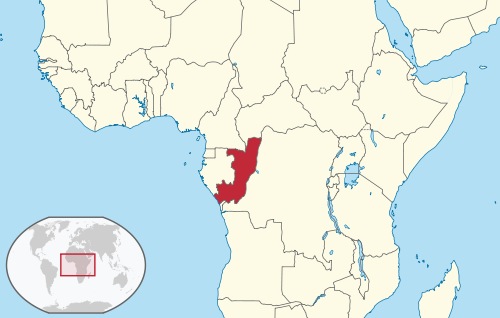

---
id    = "dc8beb90-e9a1-59af-8a97-0b5e07f4f976"
model = "Basic"
tags  = ["africa", "sovereign_state", "map"]
---

## Front

What is highlighted on this map?

## Back

<b>Republic of the Congo</b>
