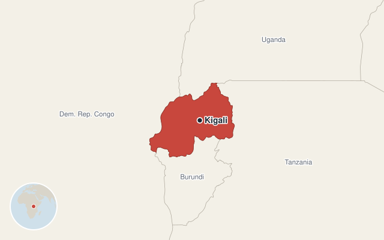

---
id    = "fcfd46db-3586-5e6d-ba15-91fe04b29f12"
model = "Basic"
tags  = ["africa", "east_africa", "sovereign_state", "capital"]
---

## Front

What is the capital of <b>Rwanda</b>?

## Back

<b>Kigali</b>

## Extra

<a href="https://en.wikipedia.org/wiki/Kigali">Kigali on Wikipedia</a> <a href="https://en.wikipedia.org/wiki/Rwanda">Rwanda on Wikipedia</a>
