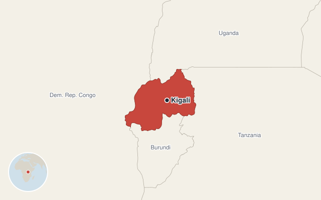

---
id    = "57d1ff0a-329a-52e5-9717-aeabe6101ab1"
model = "Basic"
tags  = ["africa", "east_africa", "sovereign_state", "country"]
---

## Front

<b>Kigali</b> is the capital of which country or territory?

## Back

<b>Rwanda</b>

## Extra

About 14.6 million people (2025) Highest point: Mount Karisimbi

Landlocked, with a tropical highland climate, and the 21st most densely populated country in the world, at about 578 people per square kilometre.

<a href="https://en.wikipedia.org/wiki/Rwanda">Rwanda on Wikipedia</a> <a href="https://en.wikipedia.org/wiki/Kigali">Kigali on Wikipedia</a>
