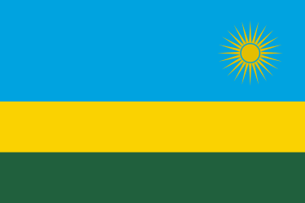
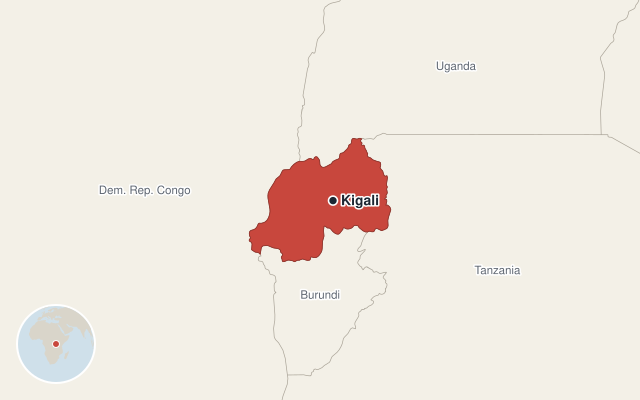

---
id    = "690ca787-ae58-584f-b2e6-56f1ddfddad0"
model = "Basic"
tags  = ["africa", "east_africa", "sovereign_state", "flag"]
---

## Front

Whose flag is this?

## Back

<b>Rwanda</b>

## Extra

Adopted on 31 December 2001

Its designer Alphonse Kirimobenecyo showed the sun illuminating Rwanda's vegetation. The golden sun stands for national unity, transparency and the enlightenment of the Rwandan people.

<a href="https://en.wikipedia.org/wiki/Flag_of_Rwanda">Flag of Rwanda on Wikipedia</a> <a href="https://en.wikipedia.org/wiki/Rwanda">Rwanda on Wikipedia</a>
