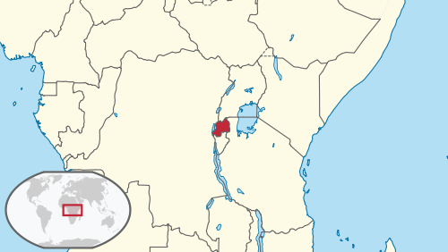
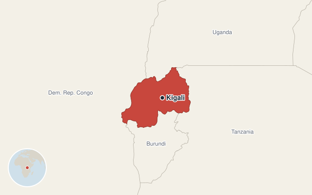

---
id    = "1331a69a-fbba-5584-ad32-5f2d0a71faa2"
model = "Basic"
tags  = ["africa", "east_africa", "sovereign_state", "map"]
---

## Front

What is highlighted on this map?

## Back

<b>Rwanda</b>

## Extra

<a href="https://en.wikipedia.org/wiki/Rwanda">Rwanda on Wikipedia</a>
