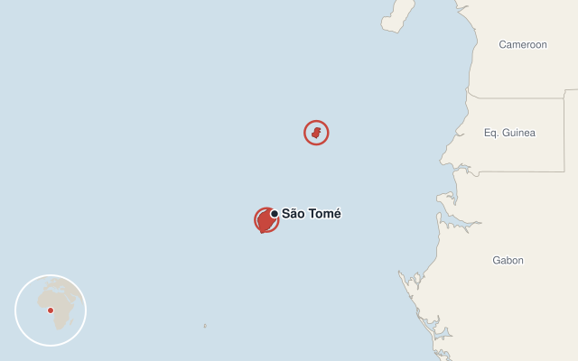

---
id    = "d6f62d14-e11f-5e76-b0f8-6b256a6d96dd"
model = "Basic"
tags  = ["africa", "sovereign_state", "capital"]
---

## Front

What is the capital of <b>São Tomé and Príncipe</b>?

## Back

<b>São Tomé</b>

## Extra

<a href="https://en.wikipedia.org/wiki/S%C3%A3o_Tom%C3%A9">São Tomé on Wikipedia</a> <a href="https://en.wikipedia.org/wiki/S%C3%A3o_Tom%C3%A9_and_Pr%C3%ADncipe">São Tomé and Príncipe on Wikipedia</a>
