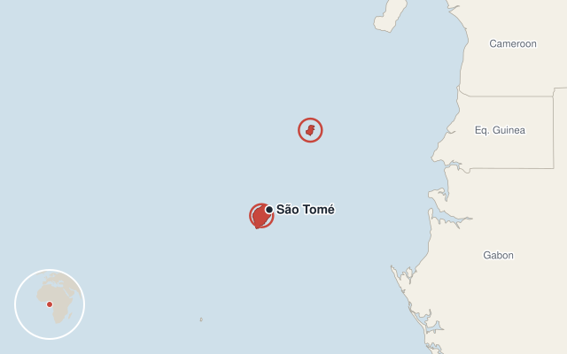

---
id    = "9af6bc14-c04b-5bd0-be9c-54773a23a9f9"
model = "Basic"
tags  = ["africa", "sovereign_state", "country"]
---

## Front

<b>São Tomé</b> is the capital of which country or territory?

## Back

<b>São Tomé and Príncipe</b>

## Extra

About 201,800 people (2018), the second-smallest African state after Seychelles Highest point: Pico de São Tomé

The islands were uninhabited until Portuguese explorers João de Santarém and Pedro Escobar discovered them on 21 December 1470.

<a href="https://en.wikipedia.org/wiki/S%C3%A3o_Tom%C3%A9_and_Pr%C3%ADncipe">São Tomé and Príncipe on Wikipedia</a> <a href="https://en.wikipedia.org/wiki/S%C3%A3o_Tom%C3%A9">São Tomé on Wikipedia</a>
