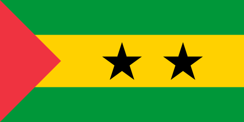
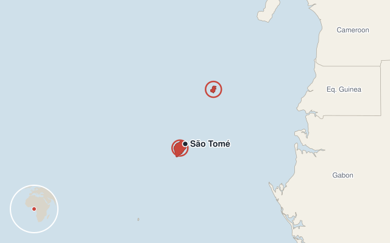

---
id    = "ac5eff9a-c1f5-557a-9e41-d510914e25d0"
model = "Basic"
tags  = ["africa", "sovereign_state", "flag"]
---

## Front

Whose flag is this?

## Back

<b>São Tomé and Príncipe</b>

## Extra

<a href="https://en.wikipedia.org/wiki/Flag_of_S%C3%A3o_Tom%C3%A9_and_Pr%C3%ADncipe">Flag of São Tomé and Príncipe on Wikipedia</a> <a href="https://en.wikipedia.org/wiki/S%C3%A3o_Tom%C3%A9_and_Pr%C3%ADncipe">São Tomé and Príncipe on Wikipedia</a>
